# 16 Data Decomposition + 53 Entropy Features Extraction + N Machine Learning Classifications for Full Fault Diagnosis Process! Updates are ongoing!!

This issue is undoubtedly a masterpiece in the field of content creation!
For more details, please refer to the following link:
Who among us doesn't know how to write an academic paper? This issue includes 16 methods for data decomposition + 53 methods for entropy feature extraction + various machine learning classification methods for a full process of fault diagnosis!
This tweet directly encapsulates 16 methods for data decomposition + 53 methods for entropy feature extraction + numerous machine learning classification methods. Just randomly combining these could easily turn into a watered-down journal paper (here only for watered-down papers!). Mastering this article will allow you to master fault diagnosis!
Here's a tip for beginners who are just starting out with fault diagnosis: Don't start off with too complex techniques right away. This code is indeed a gem, and it's all very basic, making it perfect for beginners!
This issue's tweet can directly reproduce many main methods from many journals (with some fine-tuning needed on the details!), such as:
Chen Aiwu, Wang Hongwei. Fault Diagnosis of Planetary Gearbox Based on HBA-ICEEMDAN and HWPE [J]. Mechanical Engineering, 2023, 40(08):1157-1166.
Wang Xinyun, Lin Zhenyuan, Hu Leilei, et al. Fault Research on Rolling Bears Based on VMD Arrangement Entropy and FASSA-SVM [J]. Industrial Safety and Environmental Protection, 2023, 49(03):63-68.
Liu Kai, Li Lei, Wang Lei, et al. Fault Diagnosis of Gearbox Based on ICEEMDAN and PFA-ELM [J]. Manufacturing Technology and Machine Tools, 2023(05):21-27.
Bian Dongxue, Zhang Jinping. Application and Research of LMD Approximation Entropy and Improved PSO-ELM for Bear Fault Diagnosis [J]. Machine Tools and Hydraulic Presses, 2023, 51(14):227-232.
Shen Tong. Application and Research of Variational Mode Decomposition in Rolling Bear Fault Diagnosis [D]. Changchun University of Science and Technology, 2021.
Gao Xianlei, Zhao Baiting, Jia Xiaofen. Optimized VMD based on OCSSA for Rolling Bear Fault Diagnosis Method [J/OL]. Chongqing University of Economics and Business, Science Edition, 1-8[2024-04-18].
Lv Jide, Qi Mingsi, Shi Yanhao. Improved VMD and HP-based Rolling Bear Fault Diagnosis Method [J]. Mechanical Design and Manufacturing Engineering, 2024, 53(02):93-99.
Xu Haofei, Pan Cunzhi. ICEEMDAN-MPE and GWO-SVM-based Rolling Bear Fault Diagnosis Method [J]. National Defense Transportation Engineering and Technology, 2024, 22(01):33-37+96.
Lu Xiaopeng, Chen Guiping, Jiang Chaowu, et al. VMD Arrangement Entropy and ELM-based Rolling Bear Fault Diagnosis [J]. Equipment Manufacturing Technology, 2023, (12):24-27+50.
There are so many references on this topic! Here's no need to list them all.
The question arises: since so many papers have been published, can I still publish one?
Don't forget that this issue introduces 15 data decomposition methods, 6 entropy feature extraction methods, and N multiple machine learning classification methods. Those who can combine well can calculate how many papers they can publish! Moreover, you can add some intelligent optimization algorithms like in the reference papers mentioned above, optimize the feature extraction methods, or combine the entropy values differently, or apply it to different fields, etc.
The fault diagnosis approach in this issue is as follows:
1. Choose one of the 16 data decomposition methods to decompose the data.
2. Obtain N IMF components and calculate the correlation coefficient between each IMF component and the original signal.
3. Select the M IMF components with the largest correlation coefficients for entropy calculation (choose 1 from 53) to construct the feature vector.
4. Train a machine learning classification algorithm with the constructed feature vectors for fault diagnosis.
The data decomposition methods included in this issue are as follows:
Method1 = 'FEEMD';
The entropy feature extraction method contained in this issue's tweet is as follows:
Feature Extraction Method Selection
After feature extraction, directly place the extracted feature vectors into the third step folder to achieve fault classification with a single click. This issue article integrates three commonly used machine learning classification algorithms, which you can freely choose from!
The code directory screenshot for this issue is as follows:

You can see that there are three steps, each containing detailed program operation instructions. The instruction screenshot is as follows:
Result display:
Classification results:
This issue article combines three machine learning classification algorithms, and for more machine learning classification algorithms, you can refer to the following link:
Machine Learning Classification Kit, Pattern Recognition, See this post absolutely enough! MATLAB Code
This work will continue to iterate, and currently it is not the final version. If you want to get it early, you'll have a head start, and later on, there might be price increases!
Updated again on June 3, 2024
Previously published an article, this issue article builds upon that one, adding another 13 types of entropy to further enhance your paper's innovation points!
Currently, the program includes 15 data decomposition methods + 19 entropy feature extraction + 3 common machine learning algorithms.
The 15 data decomposition methods included in this issue article are as follows:
method1 = 'FEEMD';
% Available methods include:
% VMD (Variational Mode Decomposition)
% SVMD (Successive Variational Mode Decomposition)
% SSD (Singular Spectrum Decomposition)
% RLMD (Robust Local Mean Decomposition)
% MVMD (Multivariate Variational Mode Decomposition)
% LMD (Local Mean Decomposition)
% ICEEMDAN (Improved Adaptive Noise-Compliant EMD)
% FEEMD (Fast EMD Decomposition)
% EWT (Empirical Wavelet Decomposition)
% EMD (Empirical Mode Decomposition)
% EEMD (Ensemble Empirical Mode Decomposition)
1. CEEMDAN (Completely Adaptive Noise-based Ensemble Empirical Mode Decomposition)
2. CEEMD (Complementary Set Empirical Mode Decomposition)
3. SGMD (Singular Geometric Mode Decomposition)
4. SSA (Singular Spectrum Analysis)
It can be seen that this code compiles many common and uncommon data decomposition algorithms, and if you want to change the method of data decomposition, just modify the "method1" here!
This article includes 19 methods of entropy feature extraction as follows, and the translation of some entropy may not be accurate (specific can refer to the literature of each entropy function, which are all commented in the code).
%% Methods of feature extraction selection
% Select which method to use for constructing the feature vector!
method2 = 'SampleEntropy';
% The unified basis for constructing the feature vector is:
% Select the top 6 IMF components with the highest correlation coefficient,
% then calculate the corresponding entropy values, and construct the feature vector
% Optional methods include:
% Approximate entropy: 'kApproximateEntropy'
% Sample entropy: 'SampleEntropy'
% Permutation entropy: 'PermutationEntropy'
% Energy entropy: 'EnergyEntropy'
% Information entropy: 'InfoEntropy'
% Fuzzy entropy: 'FuzzyEntropy'
% Attention entropy: 'AttentionEntropy'
% Conditional entropy: 'ConditionalEntropy'
% Bubble entropy: 'BubbleEntropy'
% Cosine similarity entropy: 'CosineSimilarityEntropy'
% Dispersion entropy: 'DispersionEntropy'
% Distribution entropy: 'DistributionEntropy'
% Diversity entropy: 'DiversityEntropy'
% Grid-based distribution entropy: 'GridEn'
% Incremental entropy: 'IncrementEntropy'
% Kolmogorov entropy: 'Kolmogorov'
% Phase entropy: 'PhaseEntropy'
% Slope entropy: 'SlopeEntropy'
% Symbolic dynamic entropy: 'SymbolicDynamicEntropy'

If you want to change the method of feature extraction, simply modify the "method2" here!
This article includes three commonly used machine learning classification algorithms:
1. Backpropagation Neural Network (BPNN)
2. Support Vector Machine (SVM)
3. Extreme Learning Machine (ELM) with Particle Swarm Optimization (PSO) for optimization

By randomly combining these three methods, there are 855 combinations, each of which could be a water journal paper (here only water journals are considered!). Once you learn this one, you can master fault diagnosis!

Results display, randomly combine a few cases for demonstration:
1. VMD-AttentionEntropy (Attention Entropy) - SVM
2. FEEMD-SampleEntropy (Sample Entropy) - BP
3. RLMD-DispersionEntropy (Dispersion Entropy) - PSO-ELM
4. MVMD-BubbleEntropy (Bubble Entropy) - SVM

The remaining cases will not be displayed one by one because they are too numerous!
For more machine learning classification algorithms, refer to the following link:
Machine Learning Classification All-in-One, Pattern Recognition, see this absolutely enough! MATLAB Code

## Images

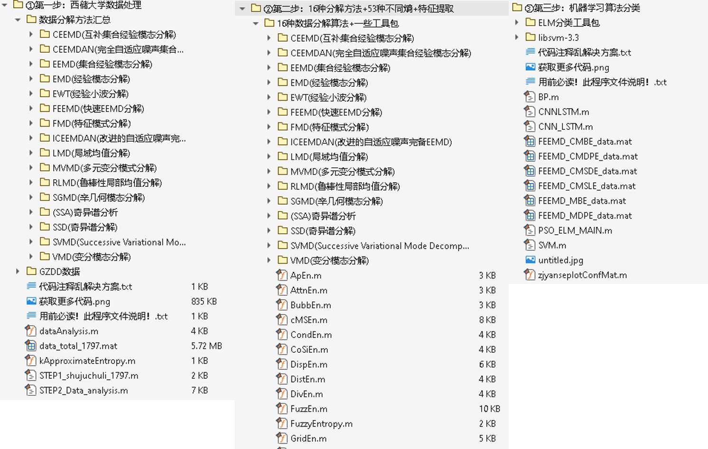
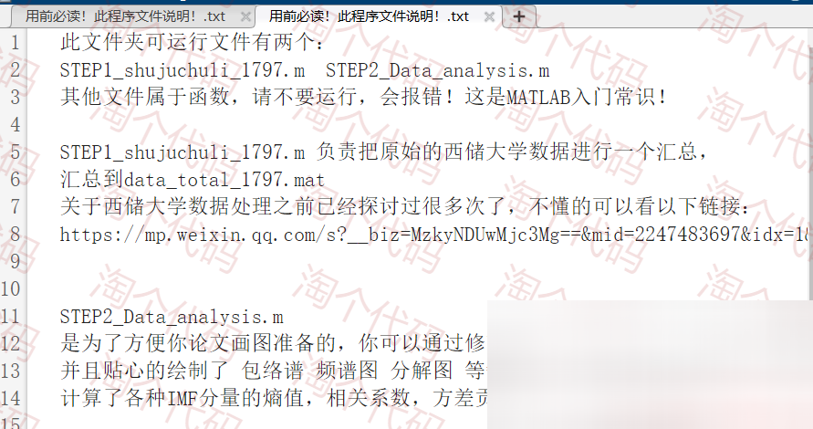
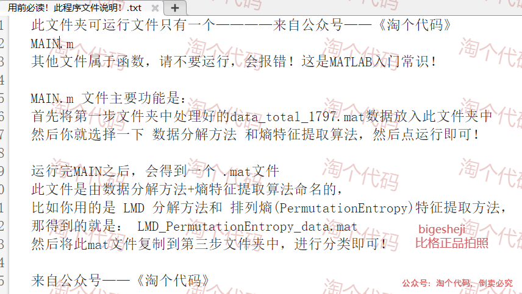
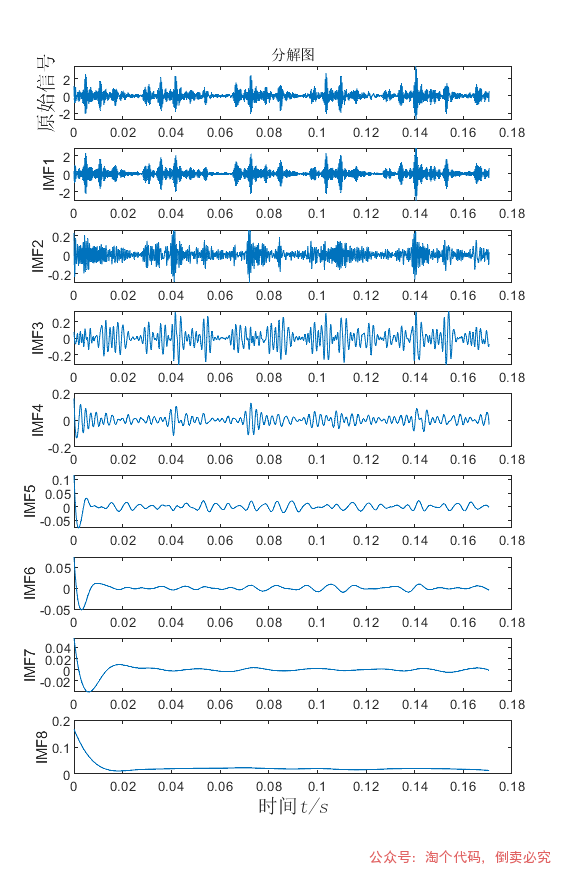
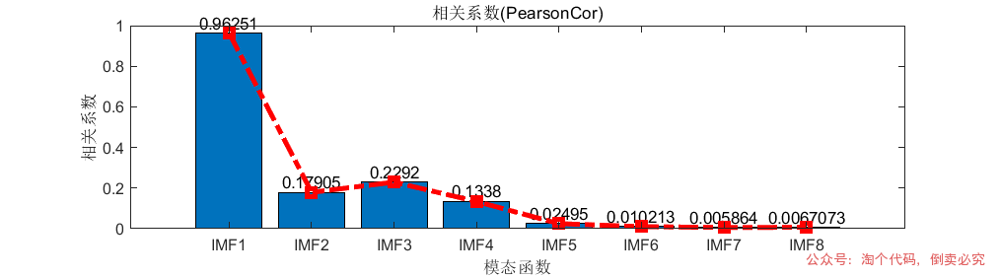
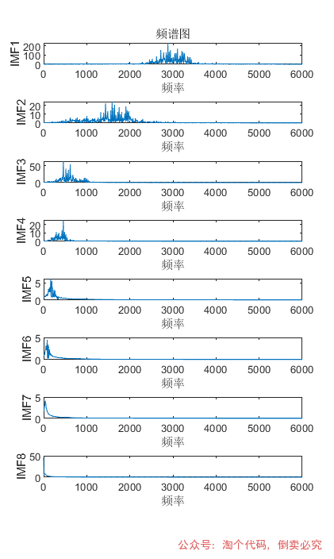
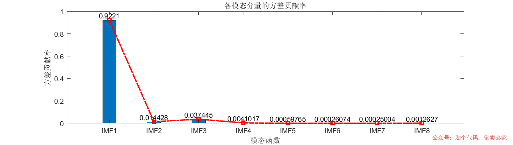
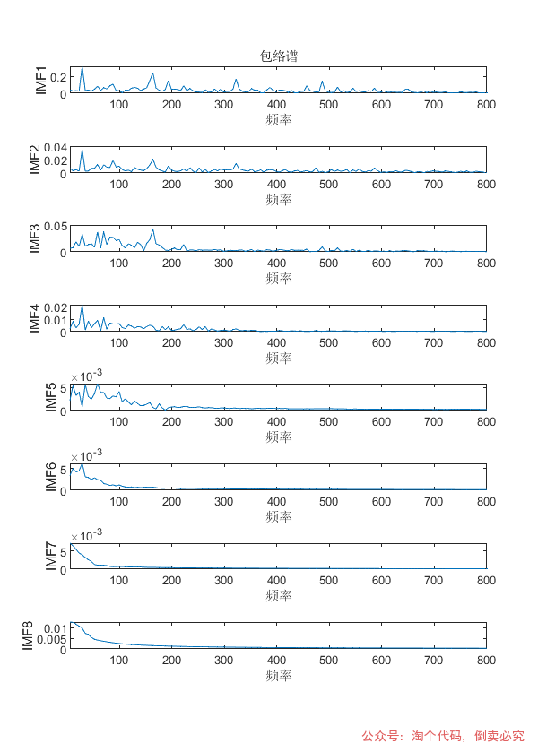
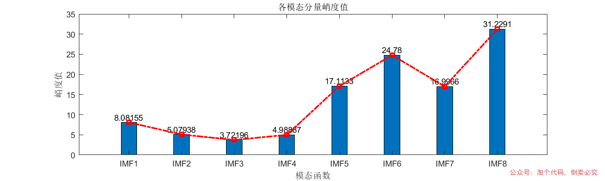
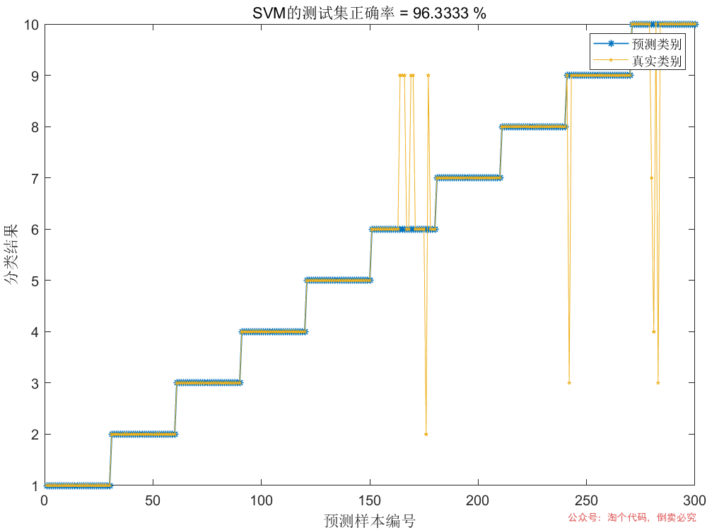
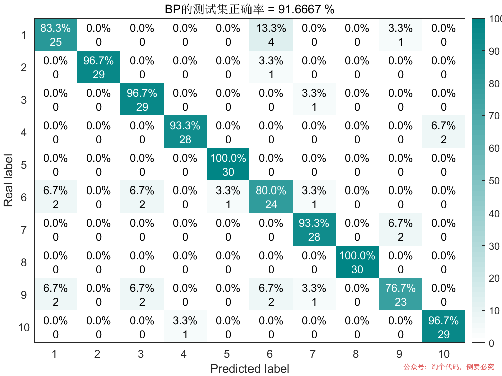
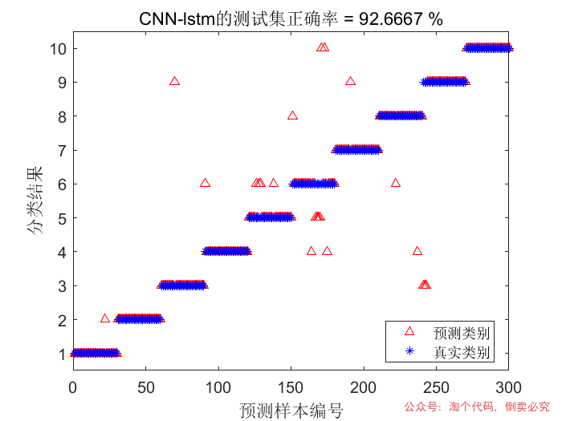
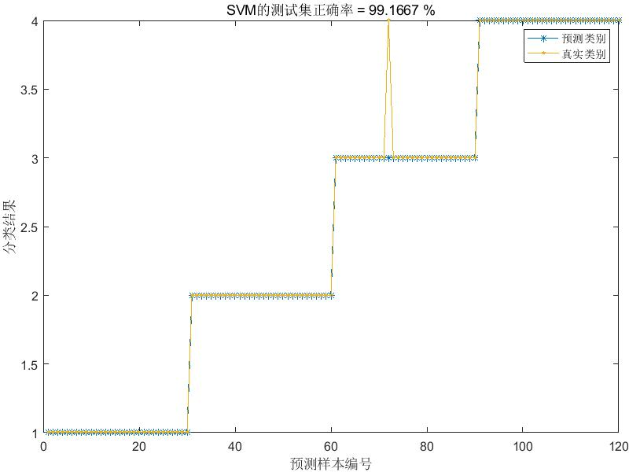
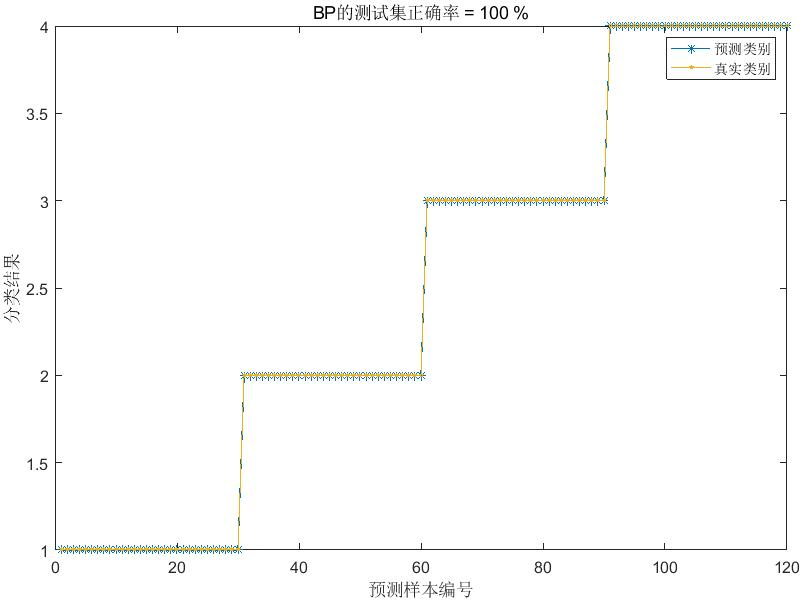
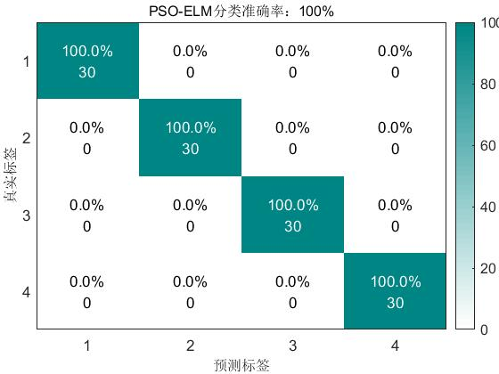
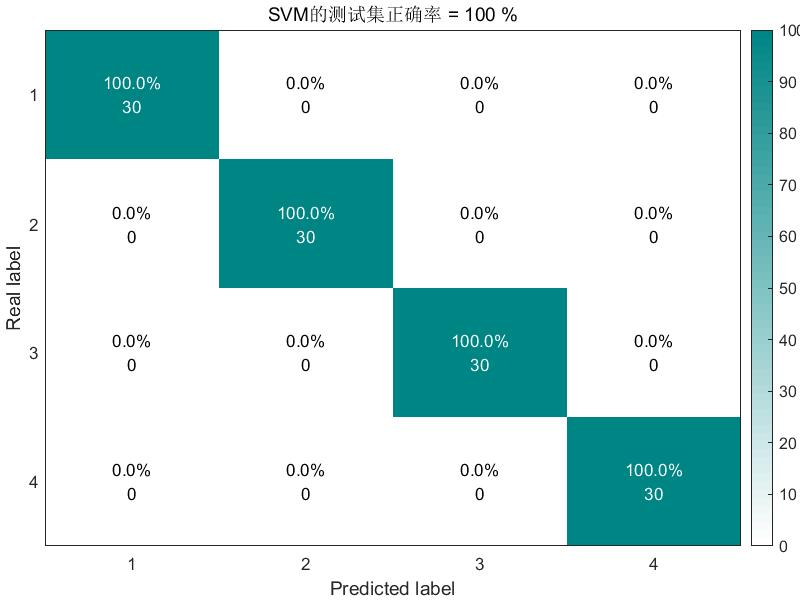

<!-- PAYMENT_BLOCK -->

## Get this dataset

- Payment link (Stripe): [Buy now](https://buy.stripe.com/3cs8yP7sY87d0vu9AB)
- Payment QR code: 

<!-- /PAYMENT_BLOCK -->
